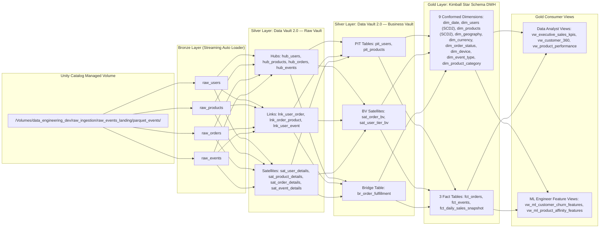
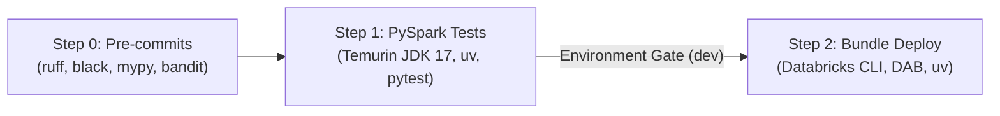

# Enterprise Data Vault 2.0 & Kimball Dimensional DWH on Databricks Lakehouse

An end-to-end **Databricks Lakeflow Spark Declarative Pipelines (`pyspark.pipelines`)** and **Functional PySpark** project that appends incremental batches of synthetic e-commerce event Parquet files into a Unity Catalog Managed Volume on each run, streams new files via Auto Loader (`cloudFiles`), constructs an auditable **Data Vault 2.0** architecture (**Raw Vault** and **Business Vault**), builds a full **Kimball Dimensional Data Warehouse** (**Star Schema** with 9 Conformed Dimensions and 3 Fact tables), and exposes governed analytical views for **Data Analysts** and **ML Engineers**.

---

## 1. Architectural Overview & Medallion Mapping



### Unity Catalog 3-Level Namespace (`data_engineering_dev`)

Every catalog, schema, table, and column in the project is provisioned with an explicit Unity Catalog `COMMENT` description across **37 tables and materialized views**:

| Layer | Schema | Object Type | Tables / Views (37 Total) |
| :--- | :--- | :--- | :--- |
| **Landing** | `raw_ingestion` | Managed Volume | `/Volumes/data_engineering_dev/raw_ingestion/raw_events_landing/parquet_events/{users,products,orders,events}` |
| **Bronze** | `bronze` | Streaming Tables | `raw_users`, `raw_products`, `raw_orders`, `raw_events` |
| **Silver (Raw Vault)** | `silver` | Materialized Views | **Hubs**: `hub_users`, `hub_products`, `hub_orders`, `hub_events`<br>**Links**: `lnk_user_order`, `lnk_order_product`, `lnk_user_event`<br>**Satellites**: `sat_user_details`, `sat_product_details`, `sat_order_details`, `sat_event_details` |
| **Silver (Business Vault)** | `silver` | Materialized Views | **PIT**: `pit_users`, `pit_products`<br>**BV Satellites**: `sat_order_bv`, `sat_user_tier_bv`<br>**Bridge**: `br_order_fulfillment` |
| **Gold (Kimball Dimensions)** | `gold` | Materialized Views | `dim_date`, `dim_users` (SCD2), `dim_products` (SCD2), `dim_geography`, `dim_currency`, `dim_order_status`, `dim_device`, `dim_event_type`, `dim_product_category` |
| **Gold (Kimball Facts)** | `gold` | Materialized Views | `fct_orders`, `fct_events`, `fct_daily_sales_snapshot` |
| **Gold (Analyst & ML Views)** | `gold` | Materialized Views | **Data Analysts**: `vw_executive_sales_kpis`, `vw_customer_360`, `vw_product_performance`<br>**ML Engineers**: `vw_ml_customer_churn_features`, `vw_ml_product_affinity_features` |

---

## 2. Functional Modular Code Structure

The codebase follows a strict functional programming design (`Column -> Column` expressions, atomic `DataFrame -> DataFrame` transformations composed via `.transform()` and `functools.reduce`, single-projection `.withColumns({...})` dictionaries with zero `.withColumn()` chaining, explicit `StructType` nullability contracts, immutable `@dataclass(frozen=True)` configuration, and Palantir / Lakehouse PySpark & SQL coding standards):

```text
├── apm.yml                                         # Agent Package Manager (APM) manifest
├── GEMINI.md                                       # Gemini developer & agent guidelines
├── databricks.yml                                  # Databricks Asset Bundles (DAB) Serverless Standard incremental config
├── pyproject.toml                                  # Project dependencies & static analysis configuration
├── .pre-commit-config.yaml                         # Pre-commit hooks (ruff, black, mypy, bandit, interrogate, codespell, yamllint)
├── .github/
│   └── workflows/                                  # Production CI/CD automation pipelines
│       ├── deploy-dev.yml                          # Root Orchestrator (Pre-commit -> PySpark Tests -> Bundle Deploy)
│       ├── dpl-01-precommit.yml                    # Reusable: Quality, linting & multi-engine security scans
│       ├── dpl-02-test.yml                         # Reusable: PySpark unit testing, Temurin JDK 17, uv & coverage
│       ├── dpl-03-deploy.yml                       # Reusable: Databricks Asset Bundle validation & gated deployment
│       └── README.md                               # Comprehensive CI/CD architecture & operational runbook
├── src/
│   └── python/
│       ├── modules/
│       │   ├── utils/
│       │   │   ├── config.py                       # Immutable LakehouseConfig, hash key constants, catalog/schema comments
│       │   │   └── metadata.py                     # Column description registry (100% column coverage) & DDL generators
│       │   ├── io/
│       │   │   ├── data_generation.py              # Incremental offset resolver, StructType schemas & ThreadPoolExecutor Parquet writer
│       │   │   └── volume_readers.py               # Auto Loader (cloudFiles) Parquet streaming reader & .withColumns() audit enrichment
│       │   ├── transformations/
│       │   │   ├── cleaning.py                     # Pure Column helpers, .withColumns() domain standardization & window deduplication
│       │   │   └── dq_expectations.py              # Detailed business DQX / Lakeflow rules, referential integrity, and quarantine logic
│       │   ├── data_vault/
│       │   │   ├── hashing.py                      # Deterministic SHA-256 business key & payload hashdiff expressions
│       │   │   ├── raw_vault.py                    # Modular pure builders for Hubs, Links, and Satellites
│       │   │   └── business_vault.py               # Deterministic pure builders for PIT tables, Bridge tables, and BV Satellites
│       │   └── kimball_dwh/
│       │       ├── dimensions.py                   # 9 Conformed Dimensions (dim_date, SCD2 users/products, geo, currency, status, device, event_type, category)
│       │       ├── facts.py                        # Star Schema Fact builders joining all Conformed Dimensions via surrogate FKs
│       │       └── consumer_views.py               # Governed BI Analyst KPI views & ML Feature Store views
│       └── pipelines/
│           ├── generate_parquet_events.py          # Task 01: Provisions UC metadata & appends incremental Parquet batches to Volume
│           ├── lakeflow_data_vault_pipeline.py     # Task 02a: Dedicated Lakeflow Pipeline for Bronze & Data Vault 2.0 (20 tables)
│           ├── lakeflow_kimball_dwh_pipeline.py    # Task 02b: Dedicated Lakeflow Pipeline for Kimball DWH & BI/ML Views (17 tables)
│           ├── lakeflow_data_vault_dwh_pipeline.py # Composite pipeline delegating to both Data Vault & Kimball DWH registrations (37 total)
│           ├── validate_and_audit_dq.py            # Task 03: Post-pipeline verification of row counts, DQX rules & 20 RI FK checks
│           └── verify_live_warehouse.py            # Live SQL Warehouse, Genie Space API & Genie One MCP verification script
└── tests/
    ├── conftest.py                                 # Local[1] PySpark fixture for fast unit testing
    └── test_lakehouse_suite.py                     # End-to-end unit tests (StructType nullability, incremental generation, DQX, 37 tables)
```

---

## 3. Incremental Ingestion, Serverless Standard Refresh & Data Quality (DQX)

### Incremental Raw Parquet Generation & Non-Full-Refresh Pipeline Execution
- **Incremental Volume Batch Appends**: On each run, [`resolve_next_batch_offsets`](file:///C:/Users/msede/PycharmProjects/Terraform/DatabricksDeployment/databricks_aws_deployment_05_data_vault_and_dwh/src/python/modules/io/data_generation.py) inspects the existing Parquet files in `/Volumes/data_engineering_dev/raw_ingestion/raw_events_landing/parquet_events/` and writes a new non-overlapping batch (`+120` users, `+50` products, `+400` orders, `+800` clickstream events) with `.mode("append")`.
- **Incremental Pipeline Task (`full_refresh: false`)**: The workflow task `run_lakeflow_data_vault_dwh_pipeline` runs with `full_refresh: false`, so Bronze Auto Loader (`cloudFiles`) streaming tables ingest only the newly appended Parquet files without truncating or re-reading prior batches.
- **Incremental Materialized View Refresh via Serverless Standard Mode**: Per Databricks Lakeflow documentation, incremental refresh for Materialized Views is powered by the **Enzyme** engine and is **exclusively supported on Serverless compute** (Classic compute always performs a full recompute on Materialized Views). To enable Enzyme incremental refresh while minimizing compute cost:
  - The pipeline is configured with `serverless: true` and `development: false` (production mode).
  - The orchestrating job (`end_to_end_data_vault_dwh_workflow`) sets `performance_target: STANDARD` (reducing DBU consumption by up to 70% compared to `PERFORMANCE_OPTIMIZED`, and inherited automatically by the `pipeline_task`).
  - Downstream Silver/Gold Materialized Views use deterministic upstream `_ldts` timestamps so Enzyme can incrementally maintain downstream views where cost-effective.
- **Zero Retries Across Pipeline & Workflow Tasks**: `pipelines.maxFlowRetryAttempts: "0"`, `pipelines.numUpdateRetryAttempts: "0"`, `pipelines.numStreamRetryAttempts: "0"`, and job task settings `max_retries: 0`, `retry_on_timeout: false`, `disable_auto_optimization: true`.

### Business-Oriented DQX & Referential Integrity
Data quality is powered natively by **Databricks Labs DQX (`databricks-labs-dqx`)** (`DQEngine`, `DQRowRule`, `DQDatasetRule` with `foreign_key`) alongside Lakeflow `@dp.expect_all_or_drop`:
- **20 DQX Expectation Suites** covering all Bronze streaming tables, Business Vault satellites, all 9 Conformed Kimball Dimensions, all 3 Kimball Fact tables (`fct_orders`, `fct_events`, `fct_daily_sales_snapshot`), and ML Feature views.
- **20 Referential Integrity Checks** in `validate_and_audit_dq.py` verifying zero orphan keys across Raw Vault Links and all Fact $\rightarrow$ Dimension surrogate foreign keys (`sk_date`, `sk_user`, `sk_product`, `sk_order_status`, `sk_currency`, `sk_geography`, `sk_category`, `sk_event_type`, `sk_device`).

---

## 4. Local Development, Linting & Unit Testing

### Install Dependencies
```powershell
uv sync --extra dev
```

### Run Unit Tests with Coverage
```powershell
.venv\Scripts\python.exe -m pytest --cov=src/python/modules tests/
```

### Run Static Analysis & Pre-Commit Checks
```powershell
.venv\Scripts\ruff.exe check src/python tests
.venv\Scripts\black.exe --check --line-length=120 src/python tests
.venv\Scripts\mypy.exe src/python tests
.venv\Scripts\bandit.exe -r src/python -ll -ii
.venv\Scripts\interrogate.exe -v --fail-under 95 src/python
.venv\Scripts\codespell.exe src/python tests README.md databricks.yml
.venv\Scripts\yamllint.exe -c .yamllint.yml databricks.yml .pre-commit-config.yaml
```

---

## 5. Deploying & Running via Databricks Asset Bundles (DAB) & Genie One MCP

Validate, deploy, run the workflow, and verify all 37 tables + Genie One MCP (`system.ai.genie_one_mcp`) using the `dev` profile:

```powershell
# 1. Validate bundle configuration
databricks bundle validate --profile dev

# 2. Deploy pipeline and workflow to Databricks Workspace
databricks bundle deploy --profile dev

# 3. Trigger end-to-end incremental execution
databricks bundle run end_to_end_data_vault_dwh_workflow --profile dev

# 4. Verify non-empty tables, 100% UC comments, Genie Space, and Databricks Genie One MCP
.venv\Scripts\python.exe -m src.python.pipelines.verify_live_warehouse
```

---

## 6. CI/CD Deployment Pipelines (GitHub Actions)

The repository includes enterprise-grade GitHub Actions CI/CD deployment pipelines modeled after [`databricks_aws_deployment_04_unity_catalog`](https://github.com/MikolajSedek/databricks_aws_deployment_04_unity_catalog), separating execution into three distinct gates:



- **[Root Deployment Orchestrator](.github/workflows/deploy-dev.yml)**: Orchestrates triggers (`push`, `pull_request`, `workflow_dispatch`) and coordinates the three stages.
- **[Pre-commit Quality & Security](.github/workflows/dpl-01-precommit.yml)**: Runs formatters, linters, static type checking, docstring coverage ($\ge 95\%$), and secret detection via `uv`.
- **[PySpark Unit Testing & Coverage](.github/workflows/dpl-02-test.yml)**: Deploys Eclipse Temurin JDK 17 JVM, isolated `uv` virtualenv, validates wheel build (`uv build --wheel`), and executes 9 PySpark test suites with coverage upload.
- **[Databricks Asset Bundle Deployment](.github/workflows/dpl-03-deploy.yml)**: Gated deployment under GitHub Environment `dev` executing `databricks bundle validate` and `databricks bundle deploy` with OAuth Service Principal authentication.
- **[Workflows Documentation & Architecture Runbook](.github/workflows/README.md)**: Full runbook, plugin table, and secrets mapping.

---

## 7. Authoritative Skills & MCP Servers

This repository includes 11 specialized engineering skills in `.gemini/skills/` (and mirrored in `.github/copilot/skills/`):
- `databricks-data-vault-2-0`
- `kimball-dimensional-modeling`
- `databricks-spark-declarative-pipelines`
- `pyspark-style-guide` (v2.0.0 — Palantir & Mikołaj Sędek Lakehouse PySpark engineering guide)
- `lakehouse-sql-style-guide`
- `databricks-dqx`
- `functional-programming` (v2.0.0 — 3-tier functional PySpark composition with `.withColumns()`, `.transform()`, and `functools.reduce`)
- `databricks-bundles`
- `databricks-jobs`
- `pytest`
- `databricks-mcps` (configuring **Databricks Genie One MCP** (`system.ai.genie_one_mcp`) and **Databricks AI Dev Kit MCP** for conversational and SQL validation of Unity Catalog tables).
